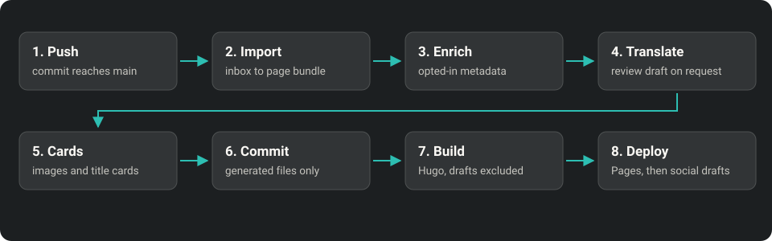
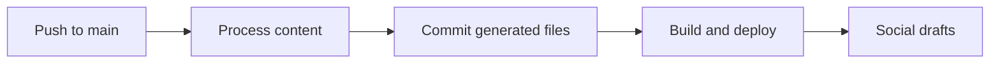

This article describes the system that publishes it. Every article on this site is a folder in a Git repository. The folder holds one Markdown file and the images that belong to it. Nothing is stored in a database.

## One folder per article

Hugo calls the folder a leaf page bundle. The date prefix keeps the folders sorted on disk, while the public address comes from the `slug` field, so the two can differ.

```text
content/en/posts/2026-11-13-how-this-site-is-published/
├── index.md       the article and its front matter
├── pipeline.svg   an image referenced from the article
└── feature.webp   generated title card, added by the pipeline
```

Norwegian articles live under `content/no/` and are served from the site root. English articles live under `content/en/` and are served under `/en/`. Two articles are linked as translations when they share the same `translationKey`.

## Two flags, two decisions

Publication and automation are separate decisions, so they are separate fields.

| Field | When it is `true` | Changed by |
|---|---|---|
| `draft` | The article stays out of the production build | The author, with `./publish.sh ready` |
| `auto_enrich` | Missing metadata may be generated through the Anthropic API | The author; the pipeline sets it to `false` after a valid result |
| `auto_translate` | A review draft in the other language is requested | The author; cleared once the draft exists |

Neither flag changes the other. An article with `draft: false` and incomplete metadata fails validation instead of being published with gaps.

## What happens on a push



The same sequence, as a diagram rendered from text:



Generated files are committed back with a message that contains `[skip ci]`, and the same run continues to build and deploy that exact commit. If someone else pushed in the meantime, the run stops instead of overwriting their work.

## The daily commands

```bash
./publish.sh new "my-post-slug" en
./publish.sh preview
./publish.sh ship "Publish my post"
```

A new article starts as a draft. Marking it ready is a deliberate step:

```bash
./publish.sh ready content/en/posts/2026-11-13-my-post-slug/index.md
```

## What is not automated

LinkedIn and X drafts are written after a successful deployment and stored as workflow artefacts. Nothing is posted to either platform. A translated article is always created as a draft and is published only after review.
