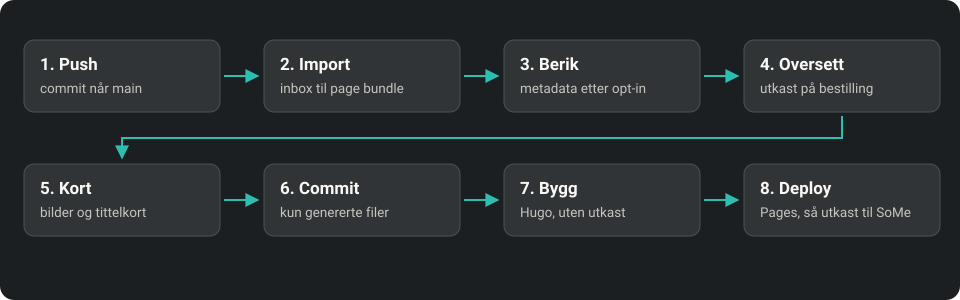
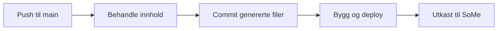

Denne artikkelen beskriver systemet som publiserer den. Hver artikkel på nettstedet er en mappe i et Git-repository. Mappen inneholder én Markdown-fil og bildene som hører til. Ingenting lagres i en database.

## Én mappe per artikkel

Hugo kaller mappen en leaf page bundle. Datoprefikset holder mappene sortert på disk, mens den offentlige adressen kommer fra feltet `slug`. De to kan derfor være forskjellige.

```text
content/no/posts/2026-11-13-slik-publiseres-dette-nettstedet/
├── index.md       artikkelen og front matter
├── pipeline.svg   et bilde som artikkelen refererer til
└── feature.webp   generert tittelkort, lagt til av pipelinen
```

Norske artikler ligger under `content/no/` og leveres fra roten av nettstedet. Engelske artikler ligger under `content/en/` og leveres under `/en/`. To artikler lenkes som oversettelser når de har samme `translationKey`.

## To flagg, to beslutninger

Publisering og automasjon er to forskjellige beslutninger, og derfor to forskjellige felt.

| Felt | Når det er `true` | Endres av |
|---|---|---|
| `draft` | Artikkelen holdes utenfor produksjonsbygget | Forfatteren, med `./publish.sh ready` |
| `auto_enrich` | Manglende metadata kan genereres gjennom Anthropic API | Forfatteren; pipelinen setter det til `false` etter et gyldig resultat |
| `auto_translate` | Et utkast på det andre språket er bestilt | Forfatteren; nullstilles når utkastet finnes |

Ingen av flaggene endrer det andre. En artikkel med `draft: false` og ufullstendig metadata feiler i valideringen i stedet for å bli publisert med hull.

## Hva som skjer ved en push



Den samme sekvensen, som et diagram rendret fra tekst:



Genererte filer committes tilbake med en melding som inneholder `[skip ci]`, og den samme kjøringen fortsetter med å bygge og deploye akkurat den commiten. Hvis noen andre har pushet i mellomtiden, stopper kjøringen i stedet for å overskrive arbeidet deres.

## De daglige kommandoene

```bash
./publish.sh new "min-artikkel" no
./publish.sh preview
./publish.sh ship "Publiser artikkelen"
```

En ny artikkel starter som utkast. Å markere den som klar er et bevisst steg:

```bash
./publish.sh ready content/no/posts/2026-11-13-min-artikkel/index.md
```

## Hva som ikke er automatisert

Utkast til LinkedIn og X skrives etter en vellykket deploy og lagres som workflow-artefakter. Ingenting postes til noen av plattformene. En oversatt artikkel opprettes alltid som utkast og publiseres først etter gjennomgang.
