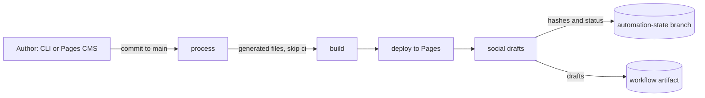

# Architecture

GitHub stores the content, Actions processes it, GitHub Pages serves static files. Pages CMS is an optional editing front end that commits to the same repository.

## Ownership of inputs and outputs

| Path | Written by | Read by | In Git | Published |
|---|---|---|---|---|
| `inbox/<lang>/*.md`, `inbox/media/` | Author, Pages CMS | Importer | Yes | Never |
| `content/<lang>/posts/<date>-<slug>/index.md` | Author; importer (creation); enrichment and translation (front matter, new bundles) | Hugo, all scripts | Yes | When `draft: false`, not future, not expired |
| Bundle images | Author; `feature.webp` by the card generator | Hugo | Yes | Derivatives only; originals excluded |
| `data/import-manifest.json` | Importer | Importer | Yes | No |
| `data/card-manifest.json` | Card generator | Card generator | Yes | No |
| `data/taxonomy-policy.yaml`, `data/automation-policy.yaml` | Operator | All scripts, `.pages.yml` generator | Yes | No |
| `.pages.yml` | `sync_cms_schema.py` | Pages CMS | Yes | No |
| `reports/` | Scripts | Workflow summary, artifact | No (ignored) | No |
| `social-drafts/` | Social generator | Artifact upload | No (ignored) | No |
| `translation-review/` | `translate --refresh` | Author | No (ignored) | No |
| `public/`, `resources/_gen/` | Hugo | Pages artifact, cache | No (ignored) | `public/` only |
| `publication-manifest.json` (in `public/`) | `build_manifest.py` | Social job, `social` command | No | Yes: identities, permalinks, hashes of published pages only |
| `automation-state` branch | Social job | Social job | Separate branch | No |

Hugo's `ignoreFiles` and the directory layout keep `inbox/`, `reports/`, `social-drafts/` and `data/` out of the site. `validate_content.py --site public` fails the build if any of them, a `.env`, or a key-shaped string appears in the output.

## Flags

| Field | Set by | Cleared by | Effect |
|---|---|---|---|
| `draft` | Author (`ready` / `draft`) | Author | `false` authorises publication. Nothing else changes it. |
| `auto_enrich` | Author, archetype, importer | Enrichment, only after a fully valid atomic write | `true` authorises one metadata generation. |
| `auto_translate` | Author | Translation, only after the target bundle is persisted | Requests a review draft in the other language. |
| `social.regenerate` | Author | Social job, after the new draft is recorded | Requests a new draft for an already published article. |
| `featured`, `featured_weight` | Author | Author | Homepage selection and order. |
| `translation.state`, `translation_reviewed` | Translation / author | Author | `machine-draft` until the author reviews; `ready` refuses an unreviewed translation. |

`draft` and `auto_enrich` never change each other. A page with `draft: false` and `auto_enrich: true` is *pending*: tolerated in pull-request checks and local `check`, fatal in the deployment workflow if enrichment did not complete.

## Processing sequence (job `process`)

1. `import_drafts.py`: new inbox files become bundles, always `draft: true`.
2. `validate_content.py --allow-pending`: structural preflight.
3. `enrich_post.py`: articles with literal `auto_enrich: true`. A failure is a warning here and a hard stop at step 6 for any ready article still lacking metadata.
4. `translate_post.py`: articles with `auto_translate: true`. A failure is a warning; the request stays set.
5. `detect_features.py`, `generate_cards.py`, `optimize_images.py`.
6. `sync_cms_schema.py --check`, `validate_content.py` (production rules), tests.
7. Commit of `content/`, `data/import-manifest.json`, `data/card-manifest.json` only. Push without force.

Jobs `build`, `deploy` and `social` then work on the commit recorded in step 7 (`content_sha`), not on the event SHA.

## Idempotency

| Component | Mechanism |
|---|---|
| Importer | Manifest entry per source path with source hash and target. Same hash: no-op. Different hash: conflict, nothing overwritten. |
| Enrichment | Eligible only while `auto_enrich: true`; the flag is cleared in the same atomic write as the metadata. A second run finds no work and needs no API key. |
| Front matter writes | The header is re-rendered; the body is the original byte slice, including final newline behaviour (`scripts/lib/fm.py`). `python-frontmatter` parses, it never serialises the file. |
| Translation | A target bundle is created once, in a temporary folder renamed into place. An existing target is never overwritten. |
| Cards | Input hash (title, primary category, language, generator version) and output hash in `data/card-manifest.json`. Re-render only when inputs change or the file is missing. |
| Images | No committed derivatives. Hugo's cache is keyed by source hash and parameters. |
| Social drafts | State records the content hash each draft represents. An article with status `done` is skipped unless regeneration is requested. |
| `.pages.yml` | Deterministic output; `--check` compares bytes. |

## Why the bot commit does not start a second run

Two independent mechanisms:

1. The commit message contains `[skip ci]`. GitHub skips `push` and `pull_request` workflows for such a commit.
2. The push uses `GITHUB_TOKEN`. Events caused by `GITHUB_TOKEN` do not create workflow runs, except `workflow_dispatch` and `repository_dispatch`.

Because of this the workflow cannot rely on a second run: `build` and `deploy` continue in the same run, from the commit `process` just pushed.

## Race handling

- **Concurrency group `publish-main`, `cancel-in-progress: false`.** One run at a time; a running job is never cancelled midway through writeback. GitHub keeps at most one *pending* run per group: a newer queued run replaces an older queued one. That is safe here because every run checks out the tip of `main` and processes everything that is pending.
- **`process` checks out `refs/heads/main`**, not the event SHA, so an earlier bot commit is included.
- **Plain push.** If `main` moved while processing, the push is rejected, the run fails before `build`, and nothing is deployed. The push that moved `main` has its own run. No force push exists anywhere in the repository.
- **Tip check.** Even with nothing to commit, the run stops when `HEAD` is no longer the tip of `main`.
- **Manual runs.** `workflow_dispatch` is refused by `scripts/lib/dispatch.py` unless started on `main`; `process` always uses the tip of `main`.
- **State branch.** Up to three attempts with fetch and rebase. The branch has one writer (this workflow), serialised by the concurrency group.
- **Clearing `social.regenerate`.** The job re-fetches `main`, edits only the flag line of files whose content hash still matches, and pushes; on rejection it restarts from the new tip, three attempts. If all fail the flag stays set and the recorded `regenerated_hash` prevents a duplicate draft.

## Publication manifest

`layouts/index.publicationmanifest.json` makes Hugo list the posts it rendered for production. `build_manifest.py` merges both languages, adds the content hash and commit, validates against `schemas/publication-manifest.schema.json` and writes `public/publication-manifest.json`:

`schema_version`, `site_origin`, `content_commit`, `hugo_version`, and per page `id` (`<lang>:<translationKey>`), `lang`, `translation_key`, `permalink`, `source_path`, `title`, `date`, `lastmod`, `content_hash`.

Drafts, future and expired pages, sections and taxonomies cannot appear because Hugo did not render them. Nothing is inferred from `git diff`, file names or the pushed file list.

## Durable social state

Branch `automation-state`, files `publications.json` and `social.json`:

- `publications`: id → permalink, source path, first publication time and commit, first and last content hash, last seen commit.
- `drafts`: id → `status` (`pending`, `done`, `disabled`, `baseline`), the content hash the draft represents, model, artifact name and run id, `last_error`, pending regeneration intent.

Publication and draft completion are separate records. A deployment that succeeds while the API fails records the publication and leaves the draft `pending`; the next run, or a `social-only` dispatch, retries without redeploying.

Properties and limits:

- No draft text and no unpublished titles are stored.
- The branch is public if the repository is public.
- It is never merged into `main` and Hugo never sees it.
- Actions cache is not used for state.

Before a draft is generated the job fetches each candidate permalink with bounded retries and requires the page's `<meta name="x-content-commit">` to equal the deployed content commit. HTTP 200 from an older deployment is not accepted.

## API failure behaviour

| Failure | Result |
|---|---|
| Missing key while work exists | Non-zero exit, files unchanged. |
| Timeout, 429, 5xx, connection error | Bounded retries with exponential backoff and jitter (`api.max_retries`). |
| `stop_reason: refusal` or `max_tokens` | Treated as failure; nothing written. |
| Output fails the JSON schema or local Pydantic and policy validation | Failure; nothing written. |
| Call or token budget reached | Remaining items reported as backlog; no success flag written. |
| Enrichment failed for a ready article | Deployment stops at final validation. Site stays on the previous version. |
| Translation failed | Target absent, request kept, other articles deploy. |
| Social generation failed | Exit 4: "site deployed; social drafts pending". Site is not rolled back. |

The model receives the article body and existing metadata as untrusted data inside a delimited block. It has no tools, fetches nothing, and its output can only fill validated fields. Secrets and repository configuration are never sent. Logs contain hashes and token counts, never request bodies.

## Security boundaries

- `check.yml` (pull requests): `contents: read`, no secrets, no writeback, no deployment. `pull_request_target` is not used.
- `deploy.yml`: top-level `permissions: {}`; `contents: write` only in `process` and `social`, `pages: write` and `id-token: write` only in `deploy`.
- `workflow_dispatch` inputs, including the Pages CMS payload, are read from environment variables by a Python validator and never interpolated into shell.
- Raw HTML in Markdown is disabled. GitHub Pages offers no response-header configuration; no file in this repository claims to set headers.
- An original image kept in a public repository is public even though it is not on the website.
